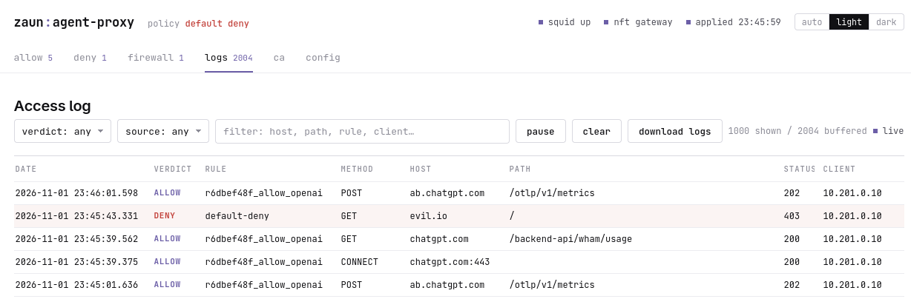

# Zaun

Zaun is an easy-to-use **HTTP proxy** and **firewall** designed to control and restrict network access for AI agents. (Keeping them behind the *Zaun*).

*This project is in lage parts vibe-coded.*

## Features

- Allow or deny HTTP, HTTPS, WS, and WSS connections based on hostname, URL path, and port.
- Allow direct TCP/UDP connections to specific hosts/ports or networks.
- Default-deny policy: All traffic is blocked unless explicitly allowed.
- Easy Web-based UI for managing firewall rules, with changes applied immediately.
- Monitor agent network activity in real time. 
- Download complete logs to find out what your agent was doing on Hugging Face.

## Web UI

## Deployment Modes

Zaun supports two deployment modes: **[Gateway](examples/gateway-mode/README.md)** and **[Container](examples/container-mode/README.md)**.

- **Gateway Mode** is designed for homelabs and network segments where Zaun acts as the default gateway and intercepting proxy. Zaun controls outbound traffic from the network, enforcing access rules for all connected agents.
- **Container Mode** is designed for containerized environments where Zaun runs as a sidecar container alongside an agent. The Zaun container acts as the agent's network gateway, enforcing access rules on its outbound traffic.

## Technology

- **Squid** handles HTTP/HTTPS filtering and TLS interception. It checks deny rules before allow rules and labels requests for the access log.
- **nftables** controls direct connections: container mode filters the pod's outbound traffic; gateway mode filters forwarded agent traffic and optionally provides IPv4 NAT. Gateway mode leaves the server's own input/output policy to its host firewall.
- **FastAPI** serves the UI and REST API. Rule changes are validated before applying them; nftables updates use an atomic transaction. Squid and ulogd2 logs feed the live log view.
- **Supervisor** runs Squid, logging and the UI together. Gateway mode runs the app as root; container mode gives the proxy `NET_ADMIN`. Container mode exempts proxy traffic using cgroups where available, with a weaker UID fallback.

Contributor commands, policy details and API notes are in [AGENTS.md](AGENTS.md).

## Configuration (env)

The example guides provide ready-to-edit configuration. These are the application defaults; example deployments may override them.

| Variable | Default | Purpose |
|---|---|---|
| `UI_USER` | `admin` | UI/API username. |
| `UI_PASSWORD` | Generated | UI/API password; saved as `ui-password` in the state directory. |
| `UI_LISTEN` / `UI_PORT` | `0.0.0.0` / `8080` | Admin interface address and port. |
| `FIREWALL_MODE` | `container` | `container` or `gateway`. |
| `FIREWALL_ENFORCE` | `1` | `0` disables firewall enforcement; unavailable in gateway mode. |
| `GATEWAY_AGENT_INTERFACE` / `GATEWAY_UPLINK_INTERFACE` | Unset | Required, distinct agent and uplink interfaces in gateway mode. |
| `GATEWAY_AGENT_NETWORKS` | Unset | Required agent CIDRs, separated by spaces. |
| `GATEWAY_MASQUERADE` | `0` | `1` enables IPv4 NAT in gateway mode. |
| `ALLOWED_CLIENTS` | Private ranges and loopback | Accepted proxy client networks; defaults to agent CIDRs in gateway mode. |
| `UPSTREAM_PROXY` | Unset | Optional HTTP/HTTPS parent proxy URL. |
| `UPSTREAM_PROXY_USER` / `UPSTREAM_PROXY_PASSWORD` | Unset | Optional parent proxy credentials. |
| `VERIFY_UPSTREAM_TLS` | `1` | Verify origin TLS certificates. |
| `DNS_REFRESH_SECONDS` | `300` | Refresh hostname-based firewall targets. |
| `CA_CN` | `Agent Proxy CA` | Name used when generating the interception CA. |
| `LOG_MAX_BYTES` | 50 MB | Access/firewall log rotation size. |
| `LOG_BACKUPS` | 20 in gateway mode, 1 otherwise | Number of access/firewall log rotations retained. |
| `DATA_DIR` | `/data` | Persistent rules, CA and generated password. The native gateway uses `/var/lib/zaun`. |

Upstream proxy and TLS verification settings can also be changed in the UI. Saved settings override their environment defaults on restart. Back up the state directory to retain your rules and CA.

## Security notes
[SECURITY-NOTES.md](SECURITY-NOTES.md)
